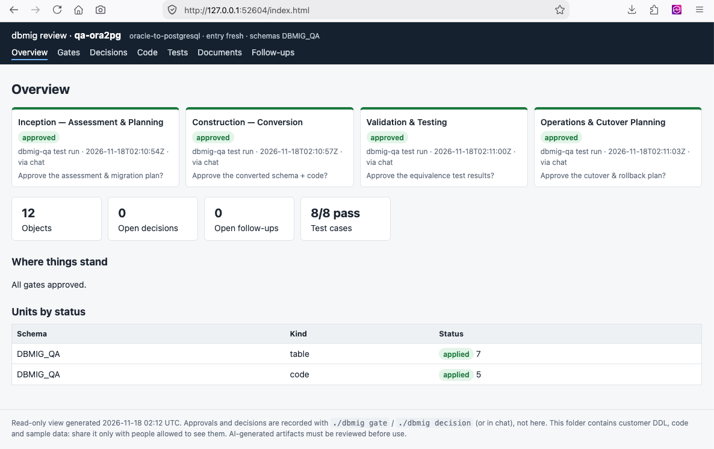

# dbmig-aidlc

An **AI-DLC-style database migration framework**. It turns a database migration into a
structured, agent-driven lifecycle — modeled on the AWS [AI-Driven Development Life
Cycle](https://aws.amazon.com/blogs/devops/ai-driven-development-life-cycle/) (AI-DLC),
where the AI acts as an *orchestrator* with clear phases, artifacts, and human decision
gates rather than a black-box code generator.

Supported engine pairs: **Oracle → PostgreSQL** and **SQL Server → PostgreSQL** (Aurora
PostgreSQL), and **Oracle → MySQL** and **SQL Server → MySQL** (Aurora MySQL). New pairs are
added through a thin engine adapter layer plus an `engines/<pair>/` definition and a playbook
(see [ARCHITECTURE.md](ARCHITECTURE.md)).

> ⚠️ **Non-production use, and AI-generated output.** This toolkit is designed for
> **development, test, and proof-of-concept** migrations — not production. Its data mover is a
> dev/test loader (production data movement hands off to AWS DMS), and every artifact it
> produces — the conversion, the equivalence tests, and especially the **Operations guides
> (cutover runbook, rollback plan, monitoring checklist)** — is **AI-generated from your
> migration's context and is a starting point, not an authoritative runbook.** You are
> responsible for reviewing, adapting, and validating everything against your own environment,
> and testing it in a non-production environment, before relying on it. See
> [DISCLAIMER.txt](DISCLAIMER.txt).

## What it does

When you start a migration, the framework interviews you (source/target engines,
connection file, what to migrate), **tests connectivity** (via Python drivers — no native
client tools), then drives the migration through four phases. You approve at each gate.

| Phase | Skill | Output |
|---|---|---|
| **Inception** — Assessment & Planning | `db-migration-inception` | Connection check, object inventory, compatibility assessment, migration plan |
| **Construction** — Conversion | `db-migration-construction` | Converted schema + stored code (LLM-driven; playbook injected as context) |
| **Validation & Testing** | `db-migration-validation` | Test-data load (or AWS DMS hand-off) + equivalence test report (same input → same value / same net effect) |
| **Operations & Cutover** | `db-migration-operations` | Cutover plan, rollback plan, monitoring |

The entry point is the `db-migration-orchestrator` skill. The conversion itself is done by the
AI assistant (Kiro or Claude Code); the `dbmig` Python toolkit does everything deterministic and
makes no LLM calls. Gate approvals and decisions are **recorded**, and `./dbmig review` builds a
read-only site to review the run. How it maps to AI-DLC: [DB-MIGRATION-AIDLC.md](DB-MIGRATION-AIDLC.md).

## Choose your path

| Your situation | Say to the assistant | Read |
|---|---|---|
| **Fresh migration**: convert from the source database | *"Start a database migration from Oracle to PostgreSQL."*<br>*"Migrate my SQL Server database to Aurora MySQL."* | the [guide for your engine pair](guides/README.md) |
| **Continue from AWS DMS Schema Conversion**: DMS SC already converted and applied the schema | *"I already ran AWS DMS Schema Conversion and applied it to the target. Import my DMS SC project at `./dms-sc-project` and continue."* | [docs/dms-sc-continuation.md](docs/dms-sc-continuation.md) |
| **Update the application** after the database migration (optional, never automatic) | *"Convert my application to work with the migrated database."* | [docs/application-modernization.md](docs/application-modernization.md) |

Prefer to answer everything up front? Add *"with a questionnaire"*: the assistant writes a
markdown questionnaire for you (or your DBA and architect) to fill in, and asks only about what
is missing ([docs/questionnaire.md](docs/questionnaire.md)). By default it asks as it goes.

## Recorded gates and the review site

Every gate approval and decision is recorded in `migrations/<project>/project.yaml`; a gate turns
**stale**, with the reason and the fix, when what was approved changes afterwards.
`./dbmig review --project <P> --open` builds a read-only site with the gates, decisions, a code
browser (source and converted side by side) and a test browser
([docs/gates-and-review.md](docs/gates-and-review.md)).



## Getting started

1. Create an **isolated virtual environment** in the repo and install the toolkit into it
   (**Python 3.10+** — check with `python3 --version`):
   ```bash
   cd dbmig-aidlc
   python3 -m venv .venv                 # .venv/ is git-ignored
   .venv/bin/pip install -e scripts/     # Windows: .venv\Scripts\pip install -e scripts/
   ./dbmig --version                     # the launcher uses .venv automatically
   ```
   **Why a venv:** the toolkit needs recent driver and security-library versions
   (e.g. `cryptography>=46`, `pyOpenSSL>=26` for CVE fixes). Installing them into your
   system or user Python could upgrade packages that other tools on your machine depend on.
   Do **not** run `pip install` against your global Python for this toolkit; `rm -rf .venv`
   removes everything. With [uv](https://docs.astral.sh/uv/):
   `uv venv && uv pip install -e scripts/`.
2. Copy the templates and fill in your connection details (or let the assistant do it, including
   from AWS Secrets Manager — see [docs/connections.md](docs/connections.md)):
   ```bash
   cp templates/connections.example.yaml connections.yaml
   cp templates/migration-config.example.yaml migration-config.yaml
   ```
   Keep secrets out of the file — use environment-variable references (see the template).
3. **Start the assistant from the `dbmig-aidlc` folder itself** (`cd dbmig-aidlc && kiro-cli
   chat`). The project steering file [`.kiro/steering/dbmig-aidlc.md`](.kiro/steering/dbmig-aidlc.md)
   ships with the repo, so Kiro recognizes the framework and follows its phases and gates. Run
   `/context show` to confirm it is loaded; if not, exit and restart from the right folder (Kiro
   loads project steering only from the folder it was started in).

   **Using Claude Code instead?** Also supported, from the same folder (`claude`). The root
   [`CLAUDE.md`](CLAUDE.md) imports the same steering file, and `.claude/skills/` exposes the
   framework skills as thin pointers to `skills/`. Check with `/memory` (or `/context`).
   Maintainers: after adding/renaming a skill or changing its `description`, run
   `python3 scripts/sync-claude-skills.py` (a unit test fails if stale).
4. Start a migration — e.g. *"start a database migration from Oracle to PostgreSQL"*. The
   orchestrator tests the connections and walks you through the phases.

## Documentation

- **[guides/](guides/README.md)** — step-by-step guides, one per engine pair, plus
  [database users and permissions](guides/database-users-and-permissions.md)
- **[docs/](docs/README.md)** — topics: [DMS SC continuation](docs/dms-sc-continuation.md),
  [questionnaire](docs/questionnaire.md), [gates, decisions and the review site](docs/gates-and-review.md),
  [how conversion works](docs/how-conversion-works.md) (full CLI pipeline),
  [connections](docs/connections.md), [run workspaces](docs/workspaces.md),
  [application modernization](docs/application-modernization.md),
  [repository layout and sample runs](docs/repository-layout.md)
- **[ARCHITECTURE.md](ARCHITECTURE.md)** — how the framework is built

Three masked, complete sample runs show every artifact without database access:
[sample-run-oracle-to-pg/](sample-run-oracle-to-pg/),
[sample-run-sqlserver-to-pg/](sample-run-sqlserver-to-pg/) and
[sample-run-dms-sc-sqlserver-to-pg/](sample-run-dms-sc-sqlserver-to-pg/)
(`./dbmig review --dir <folder> --open` renders one).

## Security & safety notes

- `connections.yaml`, `migration-config.yaml`, and `migrations/` are git-ignored by default
  so credentials and run artifacts are never committed.
- Prefer environment-variable references over plaintext passwords in the connection file; the
  questionnaire asks only for variable or secret names.
- The framework treats schema/data changes as gated actions and asks before destructive
  operations on the target.
- The review site is local and read-only, but it contains your DDL, code and sample data.

## Status

Four engine pairs are supported: **Oracle → PostgreSQL**, **Oracle → MySQL**,
**SQL Server → PostgreSQL**, and **SQL Server → MySQL**. The playbook references under
`skills/<pair>-playbook/references/` are distilled from the corresponding AWS migration
playbooks and are provided as reference only — **test everything in a non-production
environment first.**

## License

Licensed under the **MIT-0** (MIT No Attribution) license — the standard license for AWS sample
code. See [LICENSE](LICENSE). You may copy code from this repository into your own projects
without reproducing the license or attribution.
