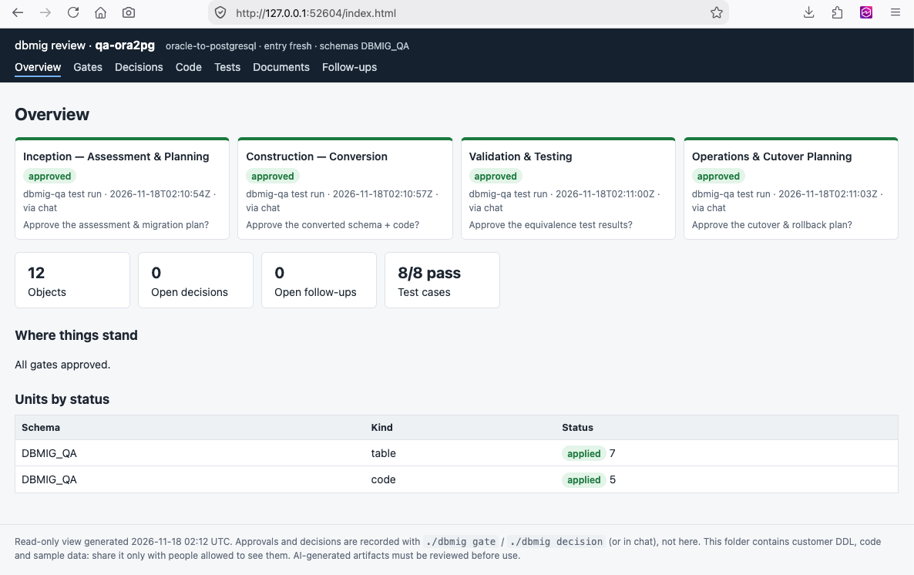
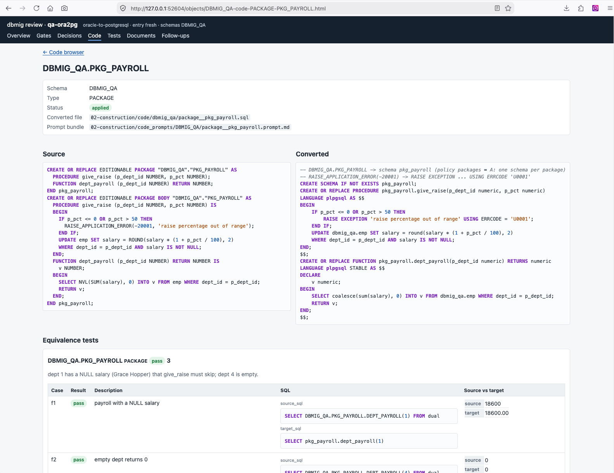

# Gates, decisions and the review site

Every phase ends at a human gate. The approvals and the decisions taken on the way are
**recorded** in `migrations/<project>/project.yaml`, so they survive the chat session and can be
reviewed later.

```bash
./dbmig gate status   --project P            # each gate: status, blockers, items to acknowledge
./dbmig gate approve  inception --project P  # on a terminal: confirm by typing the phase name
./dbmig decision list --project P --open     # ambiguities waiting for a choice
./dbmig decision answer D-001 --choice native --project P
./dbmig review --project P --open            # read-only review site
```

## Gates

| Gate | Question |
|---|---|
| Inception | Approve the assessment & migration plan? |
| Construction | Approve the converted schema + code? |
| Validation | Approve the equivalence test results? |
| Operations | Approve the cutover & rollback plan? |

- **Blockers** come from the artifacts: a missing inventory or plan, units not applied or
  `needs_human`, no reconcile or equivalence report, pending DMS SC VERIFY items, operations
  documents without the AI-generated disclaimer, open decisions, an earlier gate not approved.
  A gate with blockers cannot be approved.
- Open **follow-up items**, failed test cases and failed VERIFY items must be acknowledged
  explicitly (`--ack <kind>`, or `--ack-all`).
- Gates are approved in order: `gate approve` refuses while an earlier gate is open or stale.
- In chat, the assistant records an approval only after you say so, with `--approved-by <you>
  --via chat`. `by` records who acted; it is not authentication.
- Later-phase commands warn when their gate is not approved; set `run.enforce_gates: true` in
  `migration-config.yaml` to make them refuse.
- `./dbmig gate reject <phase> --reason "…"` records a rejection; loop back into that phase.
- Each approval also regenerates `SIGN-OFF.md` (unless a hand-written one exists).

## Stale gates: why, and how to fix

An approval stores a fingerprint of what was approved: the phase's files, its decisions, and (for
inception) the questionnaire answers. If any of them changes afterwards, the gate turns **stale**,
because what is on disk is no longer what was approved. This is expected when later work changes
earlier artifacts, for example a converted procedure fixed after an equivalence test failed makes
construction stale.

`gate status` and the review site explain each stale gate:

- **Why:** every changed, added or removed file with its modification time, and every decision
  or questionnaire answer that changed (old → new value), plus the usual cause for that phase.
- **How to fix:**
  1. Review what changed (the list, or the review site's Gates, Code and Tests pages).
  2. If the change is intended, approve the gate again (`./dbmig gate approve <phase>`, or say
     "approved" in chat).
  3. If it was not intended, restore the file: the gate turns approved again by itself once the
     content matches what was approved.
  4. A changed decision or questionnaire answer can also be set back.
- Later gates keep their approval unless their own files changed; they are shown as waiting on
  the stale gate, and no further gate can be approved until it is re-approved.

Volatile data does not make a gate stale: timestamps such as `generated_at`, the post-data status
in manifests, and the identity-reset reports rewritten at cutover.

## Decisions

`inventory`, `apply-schema`, `convert-code` and `diff-target` raise standard decisions
automatically; others are raised with `./dbmig decision raise`.

| Kind | Raised by | Options |
|---|---|---|
| `fulltext_redesign` | inventory (Oracle Text index) | PostgreSQL: `native` (tsvector + GIN), `trigram`, `external`, `drop`; MySQL: `native` (FULLTEXT), `external`, `drop` |
| `case_insensitive_collation` | inventory (SQL Server `_CI_` columns) | PostgreSQL: `citext`, `icu`, `app`; MySQL: `ci`, `cs` |
| `needs_human` | apply-schema (max retries reached) | `fix` (re-apply the hand-fixed file), `rule` (re-convert with guidance), `skip` (leave out, documented) |
| `fk_guard` | apply-schema (more FKs than the source) | `rule`, `fix`, `accept` |
| `naming_conflict` | convert-code (package routines flatten to one name) | `schema_per_package`, `separator`, `rename` |
| `diff_conflict` | diff-target (DMS SC objects missing on the target) | `apply-ours`, `keep-live`, `reconvert` |

A `needs_human` answer moves the unit in its manifest (`fix` → re-apply, `rule` → re-convert,
`skip` → skipped). Answered decisions are injected into the conversion context. An open decision
blocks its phase's gate.

## The review site

`./dbmig review` builds static, read-only HTML:





| Page | Shows |
|---|---|
| Overview | gate timeline (status, who, when, channel), counts, next gate and its blockers |
| Gates | blockers, acknowledgements, why stale and how to fix, approval history |
| Decisions | open and answered decisions, questionnaire policies, the DMS SC VERIFY ledger |
| Code | every table unit and code object; per object: source and converted code side by side, the diff from the DMS SC output, apply errors, retry prompts, conversion-log mentions, its tests |
| Tests | each case's SQL and source vs target values, failed-only filter, row-count reconcile |
| Documents | the run's markdown documents, rendered |
| Follow-ups | `follow-up.yaml` items |

```bash
./dbmig review --project P [--open] [--watch] [--serve [--port N]]
./dbmig review --dir sample-run-oracle-to-pg --out /tmp/review    # any migration folder
```

It is written to `migrations/<project>/review/` (git-ignored), or a temporary folder for a folder
outside `migrations/`. `--watch` rebuilds on changes; `--serve` serves it on `127.0.0.1` with live
reload (GET/HEAD only, Host header checked). Pages load no remote resources. Approvals and answers
are never made on the site: they go through the CLI or chat.

The site contains your DDL, code and sample data: share it only with people allowed to see them.
